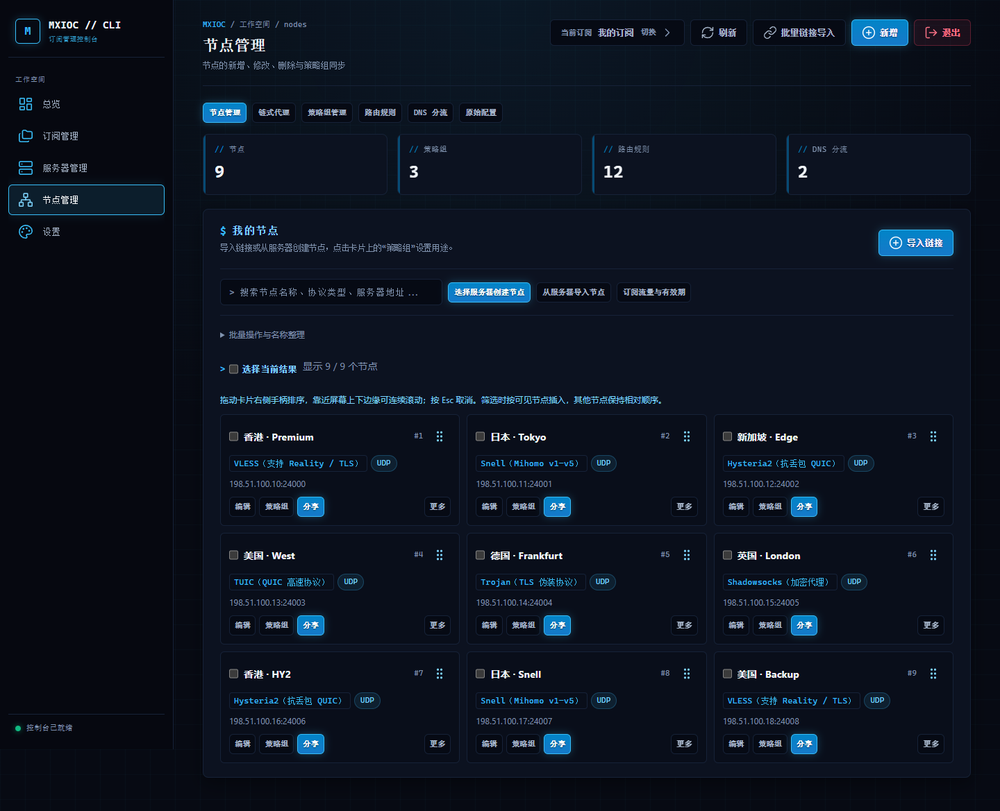
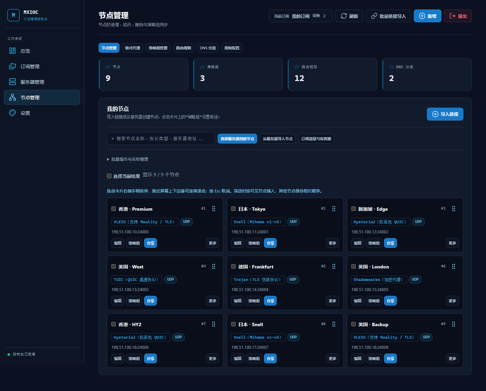
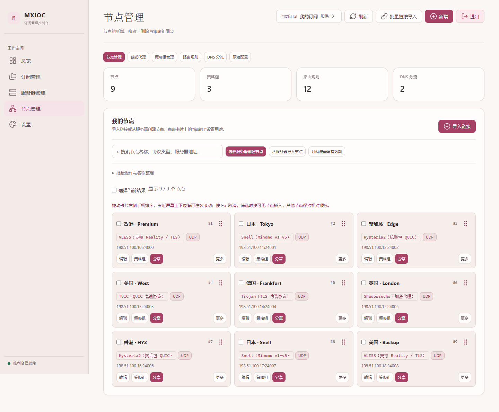

<div align="center">

# Mx-Panel

**你的节点，你的订阅，一个控制台。**

原生 Go 后端 · 可视化节点管理 · 多订阅与流量控制

[](go.mod)
[](https://github.com/Angasky/Mx-Panel/releases)
[](https://github.com/Angasky/Mx-Panel/releases)

[**下载安装**](https://github.com/Angasky/Mx-Panel/releases) · [界面预览](#界面预览) · [快速开始](#快速开始) · [使用文档](#使用文档)

</div>

---

## 一个面板，管理日常配置

| 节点与订阅 | 服务器与流量 | 分流与维护 |
| :--- | :--- | :--- |
| 分享链接导入、节点编辑与排序 | 服务器接入与独立用户管理 | 策略组、路由规则与 DNS |
| 多订阅、套餐与二维码分享 | 流量额度、倍率与到期处理 | 中转、主备与失败恢复 |
| 中文搜索、三种界面主题 | Xray / sing-box 配置管理 | 配置校验、备份与版本更新 |

支持的节点协议：

`VLESS` · `VMess` · `Trojan` · `Shadowsocks` · `Hysteria2` · `TUIC` · `Snell` · `Mieru` · `SOCKS5` · `HTTP(S)`

订阅适配 Mihomo / Clash、V2Ray 系列、Shadowrocket、sing-box、Surge、Loon、Quantumult X、Stash、Surfboard 和 Egern。后六种配置仅导出明确兼容的基础节点和手动选择组，不转换原分流规则或链路。不同协议、内核及客户端的能力边界见[客户端适配说明](docs/client-compatibility.md)。

## 界面预览

**科技主题** · 深色界面，集中展示节点与常用操作。



<table>
  <tr>
    <th width="50%">简洁主题</th>
    <th width="50%">暖粉主题</th>
  </tr>
  <tr>
    <td></td>
    <td></td>
  </tr>
</table>

<sub>主题示意截图使用示例数据；实际界面以当前发布版为准。三种主题均支持中文输入法搜索，并使用易读的中英文字体。</sub>

## 快速开始

### 一键安装（推荐）

在 root 的 SSH 终端执行：

```bash
curl -fsSL https://raw.githubusercontent.com/Angasky/Mx-Panel/main/deploy/quick-install.sh | bash
```

非 root 用户把最后的 `bash` 改为 `sudo bash`。自动识别 amd64 / arm64，下载 Releases 预编译程序并核验 SHA256；无需 Go、Python 或 Nginx。设置管理员账号后进入管理菜单。

以后输入：

```bash
mx-p
```

菜单提供 IP HTTPS、域名 HTTPS 自动证书、极速部署、升级修复、重置账号、备份、状态、日志、重启及两种卸载方式。IP/极速模式使用自签名证书（浏览器会提示不受信任）；域名模式使用 Let’s Encrypt，需要 DNS 指向本机并放行 80/443。IP 模式默认端口为 5656。

### 手动下载安装


**无需安装 Go 或 Python。** 准备一台使用 systemd 的 Linux 服务器，并具备 root / sudo 权限。

| 服务器架构 | 选择安装包 |
| :--- | :--- |
| Intel / AMD，`uname -m` 显示 `x86_64` | **linux-amd64.tar.gz** |
| ARM，`uname -m` 显示 `aarch64` | **linux-arm64.tar.gz** |

前往 [Releases 下载页](https://github.com/Angasky/Mx-Panel/releases)，下载对应压缩包、`SHA256SUMS` 和 `INSTALL-zh-CN.txt`。服务器需要 bash、curl、tar、coreutils 和 util-linux。

### 2. 校验并安装

以下以 `v0.1.34` 的 amd64 包为例；其他版本或架构请替换文件名。

```bash
# 在安装包与校验文件所在目录执行，确认对应压缩包显示 OK
sha256sum --check --ignore-missing SHA256SUMS

mkdir -p mx-panel-install
tar -xzf mxioc-go-v0.1.34-linux-amd64.tar.gz -C mx-panel-install
cd mx-panel-install

sudo bash install-go.sh fresh
```

按提示设置管理员账号与至少 **12 个字符**的密码，没有默认账号密码。`fresh` 用于首次安装；已有数据请使用下方对应操作。

### 打开管理界面

安装后运行 `mx-p`，选择 IP、域名或极速模式配置访问地址，使用菜单显示的 **HTTPS 地址**登录。Go 后端仍仅监听 `127.0.0.1:62578`，HTTPS 网关由独立的 `mx-p-gateway` 服务提供。

若已有 Nginx，可沿用自己的 HTTPS 反代，参考 [配置示例](deploy/nginx.conf.example)。**直接 HTTP 或仅 SSH 转发后端端口不能完成管理登录**。

<details>
<summary><strong>已有部署：迁移、更新与卸载</strong></summary>

在对应安装包的解压目录执行：

| 操作 | 命令 | 说明 |
| :--- | :--- | :--- |
| 迁移旧版数据 | `sudo bash install-go.sh install` | 先备份数据和凭据，停止并禁用旧版服务 |
| 更新 Go 版本 | `sudo bash install-go.sh update` | 从新版本安装包执行 |
| 卸载 Go 服务 | `sudo bash install-go.sh uninstall` | 默认保留数据 |
| 查看服务状态 | `sudo systemctl status mxioc-go --no-pager` | 查看启动状态与近期日志 |

迁移前备份 `/opt/mxioc-rule-manager` 和 `/etc/mxioc-rule-manager.auth.json`。完整流程见[安装与更新说明](docs/go/DEPLOY.md)。

</details>

<details>
<summary><strong>开发者：从源码构建</strong></summary>

使用 `go.mod` 声明的 Go 工具链，在仓库根目录执行：

```bash
bash install.sh local-build
```

双架构安装包及校验文件输出到 `dist/go-local-build/`。此命令只构建，不安装系统服务。

</details>

## 使用文档

| 想了解什么 | 从这里开始 |
| :--- | :--- |
| AI 接入、配置分析和账号隔离 | [AI 协助使用说明](docs/go/AI-ASSISTANT.md) |
| 安装、迁移、更新与卸载 | [部署指南](docs/go/DEPLOY.md) |
| 协议与客户端适配 | [客户端兼容说明](docs/client-compatibility.md) |
| Reality / Snell 兼容内核 | [补丁与构建工具](tools/core-compat/README.md) |
| 迁移进度与尚未完成的实机验收 | [当前状态](docs/go/REMAINING.md) |
| 性能测试与优化记录 | [索引优化与性能对比](docs/go/INDEX-CACHE-20261108.md) |

> [!NOTE]
> 当前为 **Go 预览版**。amd64 安装包已验证隔离初始化、数据检查与网页启动；arm64 已交叉构建，尚未实机运行。真实面板、SSH、systemd、公网及客户端 App 的完整验收仍在推进。代理内核需另行配置，兼容补丁不会随管理器自动安装。

---

<div align="center">

基于 [mxioc-vpn-manager](https://github.com/Angasky/mxioc-vpn-manager) 迁移 · 当前管理器后端使用 **Go**

[下载版本](https://github.com/Angasky/Mx-Panel/releases) · [反馈问题](https://github.com/Angasky/Mx-Panel/issues)

</div>

### 功能对照与新主题

新增暖橙主题、节点协议筛选及 sing-box 客户端配置导出。完整差异和待办见 [妙妙屋X 功能对照](docs/go/MMWX-COMPARISON.md)。这不表示对方全部功能已实现。

### 多用户与订阅授权

管理员登录后，在 **设置 → 用户与权限** 中新建普通用户、分配订阅、禁用账号或重置密码。普通用户使用同一个登录页面，只能查看已授权订阅的用量、复制地址和下载客户端配置，无法修改节点、服务器或系统设置。

- 新密码至少 12 个字符；普通用户需要重置密码时联系管理员。
- 保存账号或授权变更后，该用户的登录会话立即失效，重新登录后使用新权限。
- 禁用或删除账号不会作废已复制的公共订阅链接。需要彻底撤销订阅访问时，请同时轮换订阅地址。
- 用户记录保存在数据目录 `panel-users.json`，文件权限为 `0600`。完整迁移/备份时应保留该文件；单份订阅 YAML 备份不包含账号。 可在「账号与备份」下载密码加密的订阅配置并上传预览恢复，见[加密备份说明](docs/go/PORTABLE-BACKUP.md)。

设置中还提供原创 **暖橙主题**；节点页支持协议筛选；客户端导出新增 **sing-box**。详细适配边界见[功能对照记录](docs/go/MMWX-COMPARISON.md)。

### 历史监控

进入 **服务器监控 → 选择服务器 → 历史记录**，点击 **启用后台采样**。默认关闭；启用后无需保持网页打开，后台约每 30 秒使用已核对指纹的 SSH 采样，最多 3 台并发，服务器较多时周期会延长。

- 保留最近 24 小时 CPU、内存和网速曲线，以及最近 30 个 UTC 自然日的网卡流量观测。
- 失败或不可确认的区间显示为缺口；不把停机、重启、计数器回退、网卡切换和跨日间隔补算成完整流量。
- 网卡流量与订阅计费分开，表中显示有效观测时长与缺口次数，不应当作完整账单。
- 暂停采样保留尚未过期的记录；“清空并停用”删除该服务器历史并停止采样。
- 数据保存在 `monitor-history/`，文件权限 `0600`；普通用户无法读取或修改。服务器删除后，残留记录在 30 天未更新后清理。

### 监控分享与只读 API

管理员在 **设置 → 监控分享**（或服务器资源概览的“监控分享”）中选择服务器，填写公开名称，然后生成访问链接。默认不分享任何服务器；请先为所选服务器启用历史监控。

- 页面只显示公开名称、CPU、内存、收发速率、采样时间和采样状态，不包含 IP、SSH 信息、订阅或历史流量。
- 完整链接和 API 令牌只在生成时显示一次；服务器只保存令牌摘要。持有凭据的人无需登录即可读取所选指标，请妥善保存。
- 暂停后可重新启用原链接；更换或撤销凭据会使旧链接和旧 API 令牌失效。
- 只读接口为 `GET /sub/status-api`，使用请求头 `Authorization: Bearer <令牌>`；不支持查询参数传令牌。
- 分享页面每 60 秒刷新；数据超过 120 秒未更新时显示过期。状态表示采样结果，不代表代理连接可用性。
- 分享配置位于数据目录 `monitor-sharing.json`，权限 `0600`。现有 `/sub/` HTTPS 反向代理即可转发，无需新增监听端口。

### Surge 客户端配置

订阅总览的客户端区域新增 **Surge 客户端配置**，支持下载、复制链接与二维码；普通用户可从自己获授权的订阅卡片下载。

当前适配 Shadowsocks AEAD / 部分 SS2022、Trojan TCP/TLS、HTTP/HTTPS、SOCKS5/SOCKS5-TLS 和 Snell v1–v5 的兼容参数。输出独立的手动选择组，最终规则为 `FINAL,MX-PROXY`；**不转换原 Mihomo 分流规则、DNS、策略组、主备或链式代理**。

不兼容协议、复杂传输、TLS 客户端指纹、无法无损映射的 UDP 设置及含配置分隔符的参数会被跳过，管理员可以展开“不兼容项目”查看原因。面板默认新建的 Trojan 可能带 `client-fingerprint`，此类节点不会静默删掉指纹后导出；需要另建兼容节点或使用原始 Mihomo 配置。

实现依据 [Surge 官方配置格式](https://manual.nssurge.com/profile/format.html)及[协议文档](https://manual.nssurge.com/policies/overview.html)。已验证配置生成、注入防护、下载与权限；当前 Linux 环境没有 Surge 客户端，尚未完成 iOS/macOS 实机导入及连接验收。

### Loon 客户端配置

订阅总览新增 **Loon 客户端配置**，支持复制链接、二维码和 `.conf` 下载；普通用户可从获授权订阅卡片下载。

当前映射基础 Shadowsocks（aes-128-gcm、aes-256-gcm、chacha20-ietf-poly1305）、Trojan、VMess（aes-128-gcm）、VLESS、HTTP/HTTPS 和 Hysteria2。Trojan/VMess/VLESS 支持 TCP 与基础 WebSocket（路径和 Host）；复杂请求头、early-data、Reality、客户端指纹、链式代理、混淆及端口跳跃不在当前适配范围。

配置使用独立手动选择组与 `FINAL,MX-PROXY`，不复制原 Mihomo 分流、DNS、策略组或主备链路。含未适配参数或无法安全表示的凭据的节点会被跳过，可展开“不兼容项目”查看原因。不要把生成成功等同于客户端实机验证。

依据 [Loon 官方节点文档](https://github.com/Loon0x00/LoonManual/blob/master/docs/cn/node.md)实现。已验证协议映射、配置注入防护、下载权限与浏览器入口；当前 Linux 环境没有 Loon iOS 客户端，尚未完成实机导入与连接验收。

Agent 三模式采样、公开监控与三种 DNS 证书验证见 [接入指南](docs/go/AGENT-AND-PROBE.md)。

服务器位置地球：在“地域与续费”填写经纬度后，从“服务器监控 → 3D 地球”查看。默认私密，公开规则与数据来源见 [地球视图说明](docs/go/GLOBE.md)。

订阅连接：管理员可查看已托管独立 Xray 用户的在线 IP，并按需查询大致城市。[支持范围与开启方式](docs/go/SUBSCRIPTION-ONLINE.md)。

界面：订阅总览采用双列紧凑卡片，支持客户端跳转；设置中提供云白等五套主题。[设计与字体来源](docs/go/UI-DESIGN.md) · [妙妙屋功能差异](docs/go/MMWX-COMPARISON.md)。

我的世界主题：复用 Craft Monitor 的像素主图和原创方块材质，设置中切换。[主题说明](docs/go/CRAFT-THEME.md)。

### Telegram 通知

管理员进入 **设置 → 通知中心**，配置 Bot Token 与 Chat ID 后开启监控异常/恢复、订阅额度与到期、服务器续费提醒。默认关闭，支持阈值配置、去重和自动重试；新增每日网卡流量汇总、日报预览，以及 TCP/ICMP 延迟和失败/丢包提醒。详见 [通知中心](docs/go/NOTIFICATIONS.md) 与 [功能差异](docs/go/MMWX-COMPARISON.md)。

公开探针页支持标题、介绍、本地 Logo、四种配色及地球显隐，在 **设置 → 监控分享 → 探针站外观定制** 中配置，详见 [探针外观说明](docs/go/PROBE-APPEARANCE.md)。

订阅安全开关：**设置 → 订阅安全与兼容**，按订阅选择 STUN/WebRTC、DNS 防泄露、国内真实 IP、IPv6 与广告策略，以及实验性 Xray/sing-box 导出。[作用范围与说明](docs/go/CLIENT-OPTIONS.md)。

### Docker Compose / Alpine OpenRC

从 Release 下载独立部署工具包，可使用容器或 Alpine OpenRC 安装，不需要 Go/Python。包含 HTTPS 网关、持久化和更新说明；已有 systemd 用户继续使用 `mx-p`。详见 [部署指南](docs/go/DEPLOYMENT-ALTERNATIVES.md)。

服务器监控新增 [周期流量](docs/go/SERVER-BILLING.md)：按月/季度/半年/年查看网卡观测量、限额和有效采样时长。仅管理员可见，不等同服务商账单。

管理员设置新增 [外部订阅流量汇总](docs/go/EXTERNAL-TRAFFIC.md)：加密保存订阅地址、手动读取上游额度及到期信息、查看 30 天每日快照和累计曲线。

服务器「地域与续费」支持 [快速登记续费](docs/go/SERVER-RENEWAL.md)：预览新到期日、确认后保存、防重复提交，并提供服务商网站入口。

外部订阅流量支持按来源开启 1/6/12/24 小时自动刷新，失败退避且重启保留计划；默认关闭。

Agent 接入新增 [保留配置升级](docs/go/AGENT-AND-PROBE.md)：通过 SSH 单台升级到固定校验的 Agent v0.1.32，失败尝试恢复旧程序。面板不会自动升级远端。

管理员设置新增 Agent 分批升级：先升级首台并验收，再逐台推进；失败/上报超时停止，重启不盲目续跑。仅支持主动上报模式，默认不创建任务。

### 探针接入与分组导航

服务器管理 → 同步探针服务器：支持一键批量授权接入最多 200 台 Komari 服务器，后台自动核对结果，无需逐台填写 SSH 密码；保留原探针管理。关联服务器的硬件与 24 小时历史直接复用 Komari 数据，合并缓存请求，不再重复 SSH 采样和本地历史写入。要求 root Agent 与可达的公网 SSH，详见 [探针同步](docs/go/PROBE-SYNC.md)。

左侧订阅、服务器、节点、系统设置均可展开，直接进入流量、安全设置、分流、DNS、用户权限和通知等功能；记忆展开状态并适配手机。
